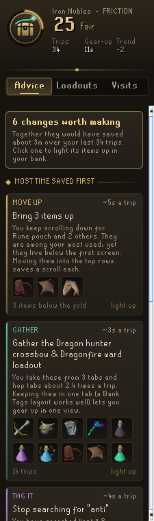
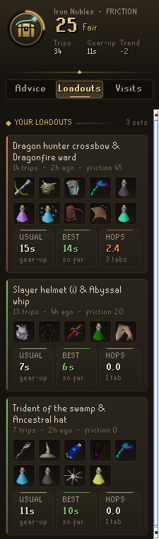
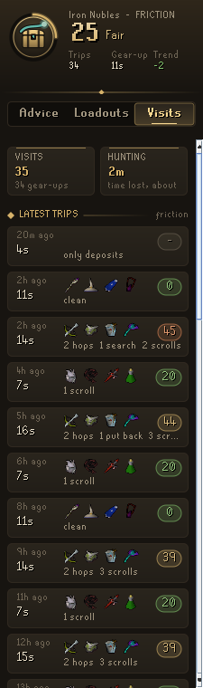
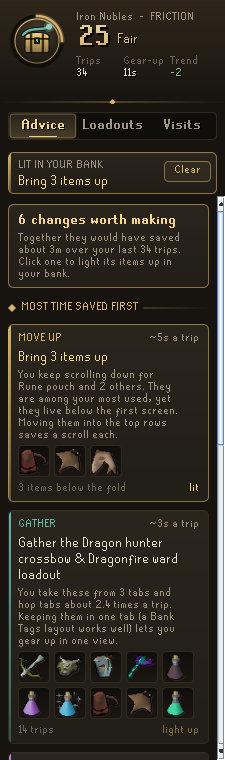

# Bank Friction Analyser

**Find what slows your banking down, and fix it.** Bank Friction Analyser watches each trip to the bank and measures the time lost to hunting for items: hopping between tabs, typing searches, scrolling below the first screen, and taking out the wrong item. It turns that into a friction score and a short list of changes to your bank layout, each with the time it saves.

It shares the look of the **Codex** suite ([Codex Navigator](https://github.com/Nubles/OSRS-Codex-Navigator), [Codex Ledger](https://github.com/Nubles/OSRS-Codex-Ledger) and the rest): warm ink, aged gold and the game's own fonts.

<p align="center">
  
  
  
</p>

## What it does

- **Friction score.** From 0 (everything at hand) to 100 (more time hunting than taking), averaged over your recent gear-ups, with a word for it (Smooth, Fair, Clunky, Tangled), your usual gear-up time and whether it is improving.
- **Advice**, most time saved first:
  - **Move up**: items you use all the time that live below the bank's first screen.
  - **Gather**: loadouts spread over several tabs or far apart rows.
  - **Tag it**: searches you keep typing, and what they find.
  - **Misclicks**: items you take out and put straight back.
  - **Decant**: partial potion doses you take out one by one.
  - **Pace**: loadouts whose usual gear-up is far slower than your best.
- **Loadouts.** The sets of items you take out together, found automatically, with your usual and best gear-up time and how many tabs they span.
- **Visits.** A log of recent bank trips with what slowed each one down.
- **Light up.** Click any advice, loadout or visit and its items are ringed in gold in your bank (placeholders too), so they are easy to find and gather.

<p align="center">
  
  
</p>

## How it measures

A visit runs from opening the bank to closing it (a bank left untouched for 90 seconds ends the visit). The plugin notes each item withdrawn, with the tab and row it came from and whether it had to be scrolled to; deposits; tab changes; finished bank searches (quantity prompts are not searches); and items dragged to a new place.

Friction is an estimate: every tab hop, search, scroll and put-back costs a few seconds, set against the second or so a well placed item needs. The same costs give each piece of advice its "about this much a trip".

History is kept per account in your RuneLite profile (150 visits by default). History from the first version of the plugin is carried over to the first account that logs in.

## Rules posture

Bank Friction Analyser only observes. It does not click, move, withdraw, deposit or tag anything, does not change menus, and sends nothing over the network. Any change to your bank is yours to make.

## Development

```bash
gradle test   # run the analysis tests
gradle run    # launch RuneLite with the plugin loaded
```

The analysis (`core/`) is plain Java with unit tests; the panel and highlight are in `ui/` and `overlay/`.
